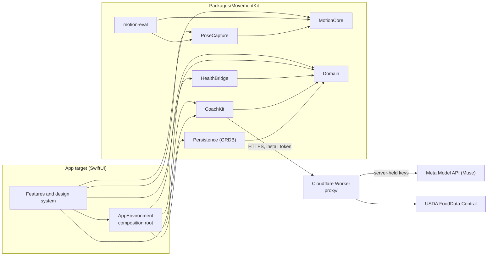

# Movement Tracker+

An iPhone coach that watches your set through the camera, counts every rep on-device, measures depth, tempo
and fatigue per rep, and has Meta's Muse model turn those numbers into coaching, plans and nutrition logging.

Built solo for the Meta Global AI Developer Hackathon 2026 (Indie track). It is a from-scratch native rewrite
of a CS440 class project; no code or assets carried over. `docs/build-log.md` lists what was committed when.

Native iOS, SwiftUI, Swift 6 strict concurrency. Deployment target iOS 27.0. Exercises with rep counting:
bodyweight squat and push-up, both filmed from the side.

## The loop

1. Frame yourself. The app checks that your whole body is in view and turned sideways before it counts.
2. Do a live set. Reps, partial reps and a depth gauge update on-device from the camera, with at most one
   spoken cue per rep.
3. Read the set review. Per-rep measurements first, then Muse's review, which cites reps by number.
4. Ask the coach. Chat answers from your own data through on-device tools; plans and meals come back as
   proposals you confirm.
5. Log a meal from a photo. Muse names the foods and estimates grams, USDA supplies the nutrients, you edit
   and save.
6. Today shows the day's nutrition, your latest workout and a weight trend. With the Apple Health switch in Me on,
   finished workouts, meals and weight are written to Health, and deleting them in the app removes them there.
   With partial Health access, the allowed types are written and the rest stay queued for a later grant. The app
   requests write access only; it does not request steps or body-weight read access.

## How it uses Muse

Muse never counts reps. Reps, partial reps, depth, tempo, velocity loss and form scores are measured on the
phone by `MotionCore`. The set review, debrief and chat prompts tell the model these are facts it must not recount,
and a review that cites a rep that does not exist is rejected. On-device numbers are the truth; Muse explains them.

| Feature | Model | Reasoning effort | What comes back |
| --- | --- | --- | --- |
| Set review | `muse-spark-1.3` | low | Strict JSON schema `SetReview`: headline, what went well, up to two fixes that cite rep numbers, next set, safety flag, confidence. Input is the per-rep numbers plus up to two skeleton drawings (best and worst rep at the bottom). Streamed. |
| Session debrief | `muse-spark-1.3` | medium | Strict schema `SessionDebrief`: summary, per-exercise verdicts, concerns, next session. Numbers only, no images. Streamed. |
| Coach chat | `muse-spark-1.3` | medium | Streamed text with function calls. Five read tools (`get_sessions`, `get_set_detail`, `get_nutrition`, `get_body_trend`, `get_goal`) run on the device against the local database. Three propose tools (`propose_plan`, `propose_meal_log`, `propose_goal_change`) only return a proposal; nothing is saved until you confirm. |
| Meal photo | `muse-spark-1.3` | low | Strict schema `MealEstimate`: foods, grams, confidence and a USDA search phrase each. One photo, not streamed. |

- **Proxy.** The app never talks to Meta directly. It calls a Cloudflare Worker (`proxy/`) that holds the Muse and
  USDA keys as Worker secrets, forwards to the Meta Responses API, allows only `muse-spark-1.3` and
  `muse-spark-1.2`, limits reasoning effort, output tokens and body size per feature, forces `store: false`,
  and enforces a daily request budget per install and a kill switch.
- **Strict schemas.** Set review, debrief and meal photo are requested with `strict: true` JSON schemas and
  decoded with Codable. A bad answer is retried once with the error. If Muse still cannot answer (bad output,
  no network, daily budget spent, service paused), the set review and debrief fall back to an on-device review
  written from the rule engine, marked as such on screen. A meal photo has no fallback and shows the error.
- **Cache.** Answers are cached by a hash of the input, prompt version, model and effort, and stored with the
  model, token usage and a "What Muse saw" record.
- **Not in the app yet.** The proxy and `CoachKit` have a voice-transcription route and the proxy has a
  spec-authoring feature; no screen uses them.

## Architecture



- `MotionCore` and `Domain` import only Foundation and do not import each other; the app maps between them.
  `swift test` builds and runs the whole package on macOS. Camera capture and HealthKit are behind
  `#if os(iOS)`.
- Each adapter depends on one core module: `PoseCapture` (AVFoundation, Apple Vision 2D body pose) on
  `MotionCore`; `Persistence`, `CoachKit` and `HealthBridge` on `Domain`. Adapters do not import each other.
- `MotionCore` is the engine: confidence gate, short-gap hold, One-Euro filter, body normalization, side lock, a
  time-based adaptive-hysteresis rep segmenter, and a rule engine driven by bundled JSON exercise specs
  (`squat.bodyweight`, `pushup`).
- The app target holds the screens and `AppEnvironment`, which builds every store from one database and passes
  them to the screens as protocols through a SwiftUI environment value. `Persistence` is imported there and
  nowhere else in the app. `AppEnvironment` also wraps the workout, nutrition, body-measurement and profile stores
  so that a successful save is queued for Apple Health (`App/Health/`); a failed Health write never fails a save.
- `motion-eval` is the accuracy tool described below.

## Privacy

- **Consent.** Coach is off until you turn it on: in Me with the Coach switch (it asks first), or with the
  Share with Muse switch on the card that the Coach sheet and the meal photo flow show while it is off.
  `Me > What Muse sees` lists the data. With Coach off nothing goes to Muse and the set review stays on-device.
- **What can leave the phone with Coach on:** your chat messages; workout numbers (sets, reps, load, depth,
  tempo, fatigue, form scores); meals (names, calories, macros); weight and body fat history, calorie targets,
  age, height and training level; up to two skeleton drawings per set review; a meal photo, only when you log a
  meal with one. Photo metadata is removed before sending.
- **Food search** sends what you type to USDA FoodData Central through the proxy, with Coach on or off.
- **Never leaves the phone:** camera video, your name.
- **Pose recordings.** Opt in with Me > Save pose recordings. End set keeps skeleton coordinates, including
  idle and missed-rep clips, with an export copy in Files > On My iPhone > Movement Tracker+ > PoseCaptures.
  No video is recorded or uploaded. Fill in the true rep counts when importing a capture for evaluation.
- **No keys in the app.** The Muse and USDA keys exist only as Cloudflare Worker secrets. The app holds an
  anonymous install token in the Keychain. The Worker logs route, status and duration only, never bodies, tokens
  or IPs, and does not allow Meta's `*-contributor` models, whose data Meta uses to improve its products.
- Launch flags are ignored in Release builds, and the canned coach stub and the debug HUD are not compiled into
  them.

## Build and test

Requires Xcode 27.1 and Node 24 or newer (proxy tests only).

```sh
swift test --package-path Packages/MovementKit
python3 -B -m unittest discover -s tools/tests -v
xcodebuild -project MovementTracker.xcodeproj -scheme MovementTracker -destination 'generic/platform=iOS Simulator' build
npm test --prefix proxy
```

The proxy deploy steps are in `proxy/README.md`. Until the Worker is deployed and its address is set in
`App/Support/CoachEndpoint.swift`, the app has no coach: the Coach sheet says it is unavailable, the set review
shows only the on-device numbers, and Eat offers manual entry only.

## Run in the Simulator with the replay fixtures

The Simulator has no camera, so a live set replays a recorded pose stream instead. The two bundled clips in
`App/Resources/ReplayPoses/` are generated (a scripted stick figure with simulated Vision noise; see
Accuracy), not recordings of a person. Regenerate them with `tools/replay-fixtures/generate.sh`.

In Xcode, pick the `MovementTracker` scheme and an iPhone simulator, then add launch arguments under Product,
Scheme, Edit Scheme, Run, Arguments. They apply to Debug builds only.

| Argument | Effect |
| --- | --- |
| `-MTInMemoryDatabase` | Use a throwaway database. |
| `-MTSeed profile` or `sample` | With the in-memory database: a finished profile, or a profile with weights, meals and a workout. |
| `-MTStartTab today\|train\|eat\|me` | The tab shown first. |
| `-MTReplayPoses squat\|pushup` | A live set replays that clip. Without it the Simulator replays on its own because there is no camera. |
| `-MTReplaySpeed 3` | Replay three times faster; counts do not change because the engine runs on recorded time. |
| `-MTReplayHoldReps 8` | Stop the replay after the 8th counted rep and leave the screen as it is. |
| `-MTCoachStub` | Canned in-process coach, no network. Screens show a stub badge. `-MTCoachStubFail offline\|budget\|paused` makes every call fail that way. |
| `-MTAIOptIn` | With the in-memory database, start with Coach consent already given. |
| `-MTCoachURL <url>` | Use a proxy at this address, for example `wrangler dev`, instead of the deployed one. |
| `-MTDebugHUD` | Show camera and engine numbers over the live set (a long press on the rep counter toggles it). |
| `-MTRecordPoses` | Record the poses of every live set to a JSONL file. |
| `-MTMealPhotoSample` | Offer a generated sample photo in the meal photo sheet. |
| `-MTCameraState denied\|restricted` | Show that camera-permission state. |

A walkthrough that needs no key and no network: `-MTInMemoryDatabase -MTSeed profile -MTStartTab train
-MTReplayPoses squat -MTCoachStub -MTAIOptIn`, then Start workout, Add exercise, Squat, Live set. With the stub
the set review shows its on-device fallback, marked as written on the device; chat and meal photo answer from
canned data and carry a stub badge. None of it is Muse.

## Accuracy

Generated by `tools/accuracy.sh` from `motion-eval`; per-clip results and definitions are in
`docs/accuracy.md`. Rows marked generated motion are scripted clips, not people.

<!-- accuracy:begin -->
| Data | Clips | Exact count | Within ±1 rep | Mean abs. error | False reps on idle clips | Partial reps exact |
| --- | --- | --- | --- | --- | --- | --- |
| Real sets recorded on iPhone | none yet | – | – | – | – | – |
| Synthetic benchmark (generated motion) | 17 | 17/17 (100%) | 17/17 (100%) | 0.00 reps | 0 over 3 idle clips | 17/17 (100%) |
| Bundled replay clips (generated motion) | 2 | 2/2 (100%) | 2/2 (100%) | 0.00 reps | no idle clips | 2/2 (100%) |

No real recordings are counted yet. Every number here comes from generated motion, not people, and the engine was tuned against that generator, so these rows are a regression check, not a measure of accuracy on people.
<!-- accuracy:end -->

Run the evaluation yourself:

```sh
swift run --package-path Packages/MovementKit -c release motion-eval --synthetic
swift run --package-path Packages/MovementKit -c release motion-eval App/Resources/ReplayPoses
swift run --package-path Packages/MovementKit -c release motion-eval --help
tools/accuracy.sh        # rebuilds docs/accuracy.md and the table above
```

`motion-eval` also reads real recordings (`.jsonl` from the app's recorder) and videos (`.mov`, `.mp4`). Real
sets recorded on an iPhone go in `fixtures/real/` through `tools/import-fixture.sh`, which labels the recording
with the counts you gave. The procedure is in `docs/device-checklist.md`.

## Real device checks

Everything that needs the iPhone or a live Muse call, in order, with pass and fail criteria:
[`docs/device-checklist.md`](docs/device-checklist.md). Until those are done, these are unverified: Vision
latency and joint stability on the device, counting accuracy on real people, live Muse answers, Apple Health
writes, and the deployed proxy.

## More

- `docs/rebuild-brief.md`: decisions, architecture, motion engine, schedule.
- `docs/accuracy.md`, `docs/build-log.md`: generated by `tools/accuracy.sh` and `tools/build-log.sh`.
- `proxy/README.md`: routes, policy table, limits, deploy.
- `docs/ios-architecture.html`: design report.
